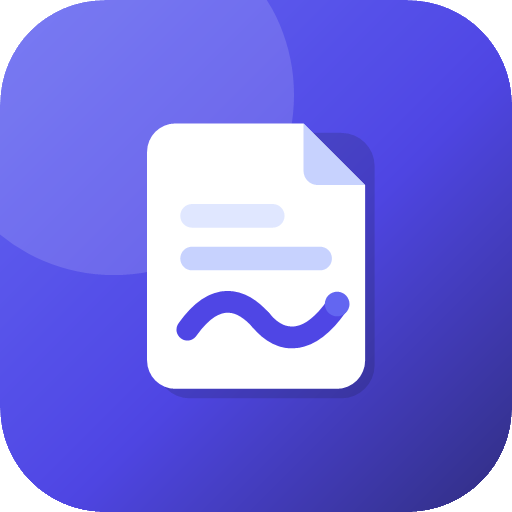

# NoteFlow



**NoteFlow** (`com.mosamir.noteflow`) — Effortless Notes & Smart Checklists with a modern Material 3 Indigo & Soft Slate design.

## Features
- **Clean Material 3 Editor**: Distraction-free note cards, undo/redo, live word counter, search & highlight, print, and file import/export.
- **Smart Checklists**: Drag-to-reorder tasks, custom sorting, collapsible completed items, and instant check-off.
- **Privacy & Security**: Per-note and app-level PIN/biometric lock, local Room database storage, JSON export/import, and scheduled automatic backups.
- **Customizable Home Widgets**: Pin notes or checklists directly to your Android home screen.
- **AdMob Adaptive Banner**: Non-intrusive anchored adaptive banner ads integrated via Google Mobile Ads SDK.

## Building & Release
1. Configure live AdMob IDs in `gradle.properties`:
   - `ADMOB_APP_ID`
   - `ADMOB_BANNER_AD_UNIT_ID`
2. Configure release signing in `keystore.properties` (see `keystore.properties_sample`).
3. Build release bundle for Google Play:
   ```bash
   ./gradlew bundleGplayRelease
   ```
4. Build release APK:
   ```bash
   ./gradlew assembleGplayRelease
   ```

## License
NoteFlow is licensed under the **GNU General Public License v3.0 (GPLv3)** (see [LICENSE](LICENSE)). Based on the open-source Fossify Notes project, with upstream copyright notices and GPLv3 freedoms preserved.
